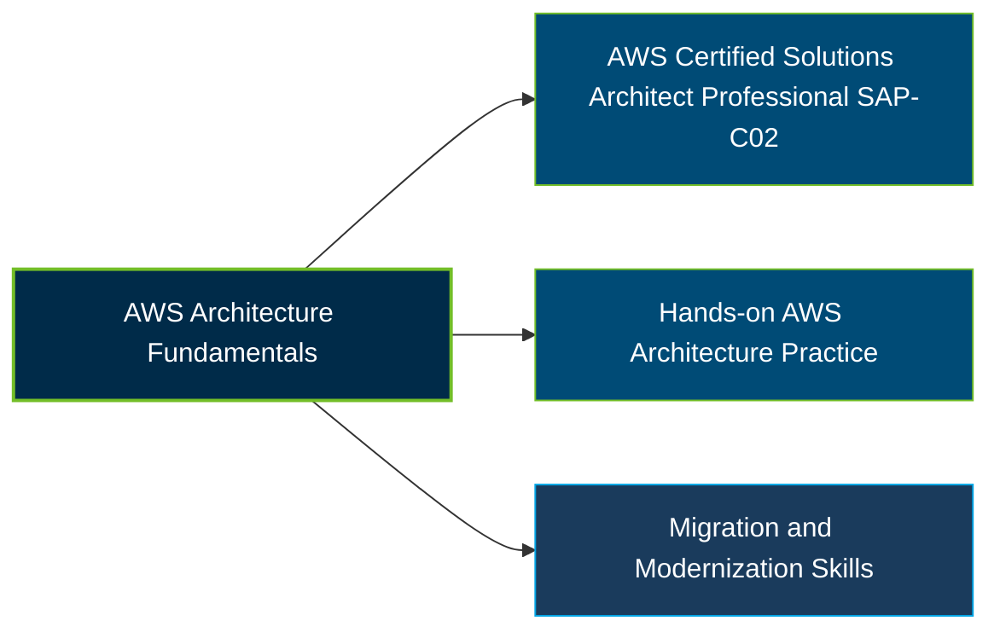

# AWS Certified Solutions Architect - Professional Certification Exam Guide

A dedicated, comprehensive study guide and cloud architecture reference repository for candidates preparing for the **AWS Certified Solutions Architect - Professional (SAP-C02) Certification Exam**.

---

## Exam Overview

The AWS Certified Solutions Architect - Professional certification validates advanced skills in designing optimized AWS solutions using the AWS Well-Architected Framework across complex organizations, new architectures, existing workloads, and migration initiatives.

- **Exam Format**: Multiple-choice and multiple-response questions
- **Target Audience**: Solutions Architects, Cloud Architects, Enterprise Architects, and experienced AWS professionals
- **Prerequisites**: No mandatory prerequisite certification; AWS identifies two or more years of hands-on experience designing and implementing AWS cloud solutions as the target candidate profile

---

## Core Exam Domains & Knowledge Areas

### 1. Design Solutions for Organizational Complexity

- Designing multi-account environments, organizational governance, and cross-account access.
- Building secure, scalable architectures across multiple AWS accounts and networks.
- Addressing complex organizational requirements, identity, and connectivity.

### 2. Design for New Solutions

- Designing resilient, high-performing, and secure cloud architectures.
- Selecting appropriate AWS services based on business and technical requirements.
- Applying architectural principles for scalability, availability, and cost optimization.

### 3. Continuous Improvement for Existing Solutions

- Evaluating existing workloads for performance, reliability, and operational improvements.
- Improving security, monitoring, and cost efficiency across deployed architectures.
- Applying the AWS Well-Architected Framework to identify and address design weaknesses.

### 4. Accelerate Workload Migration and Modernization

- Assessing workloads and selecting suitable migration strategies.
- Planning application, database, and infrastructure migration to AWS.
- Modernizing legacy workloads to improve scalability, resilience, and maintainability.

---

## Certification Path

This is a suggested study progression, not an official AWS prerequisite or mandatory certification sequence.

---

## Recommended Practice & Study Resources

Combine official AWS exam preparation materials with practical architecture exercises to strengthen your understanding of complex cloud solutions.

- **Official AWS Resources**: Review the [AWS Certified Solutions Architect - Professional page](https://aws.amazon.com/certification/certified-solutions-architect-professional/) and the [official SAP-C02 exam guide](https://docs.aws.amazon.com/aws-certification/latest/solutions-architect-professional-02/solutions-architect-professional-02.html).
- **CertsGate**: See the [SAP-C01 preparation page](https://certsgate.com/exams/amazon/sap-c01) for supplementary practice material. This page is for the older exam code; verify topics against the current SAP-C02 exam guide before relying on it.
- **AWS Well-Architected Framework**: Study the [official framework documentation](https://docs.aws.amazon.com/wellarchitected/latest/framework/welcome.html) and apply its principles to real or sample AWS architecture scenarios.
